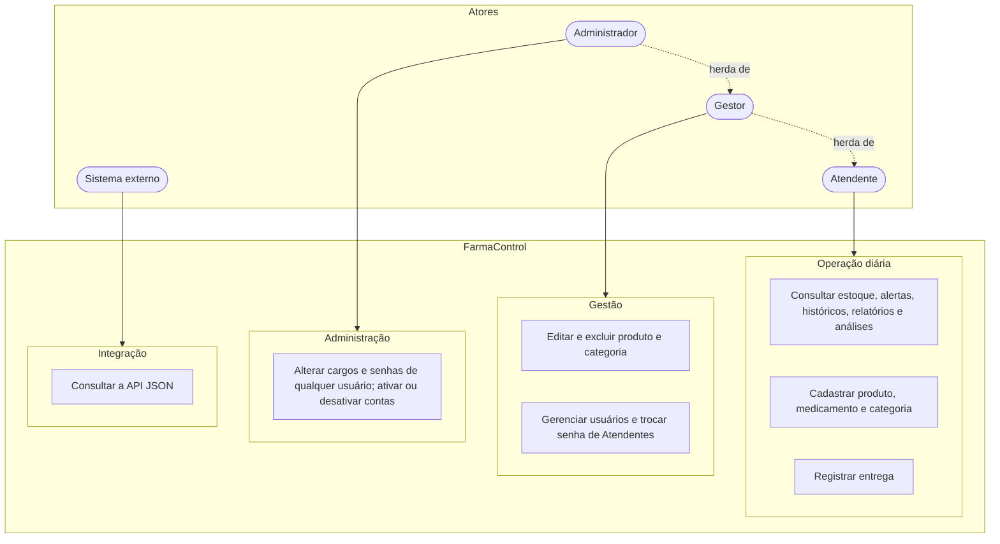
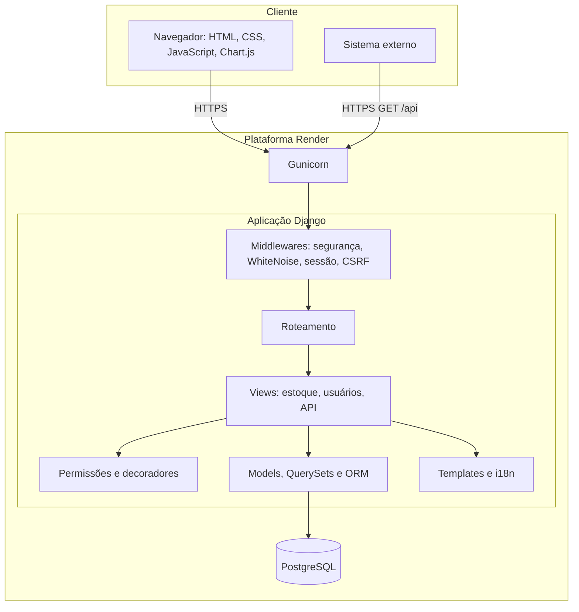
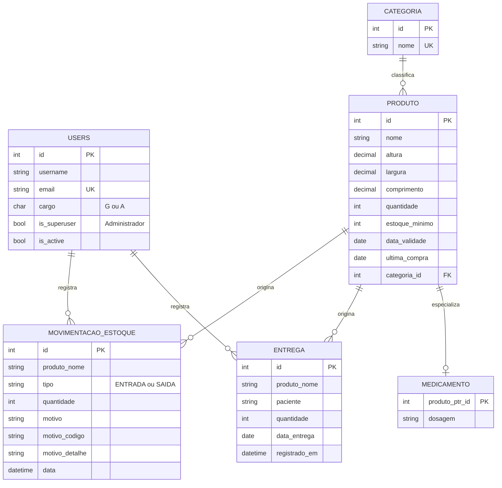
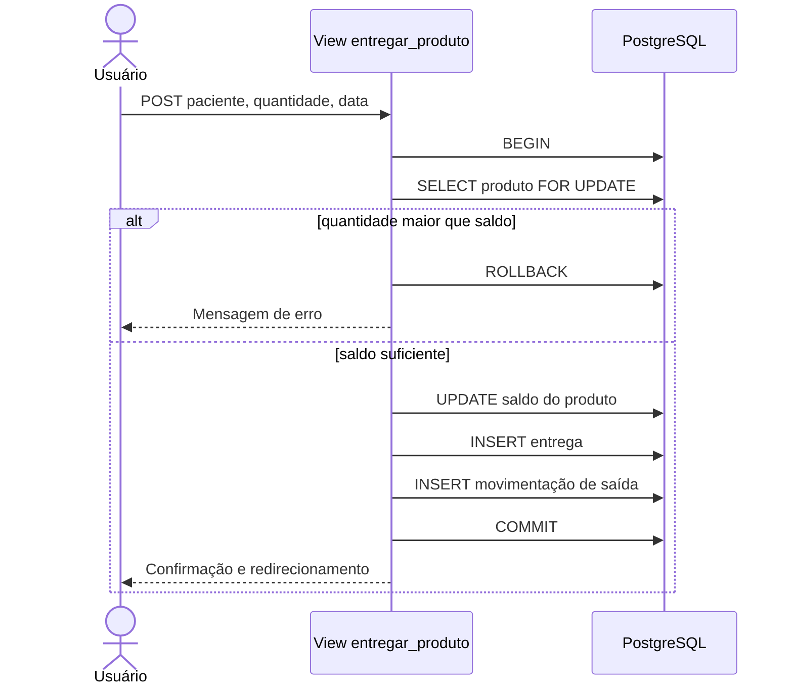
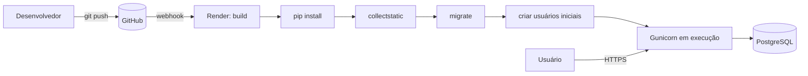

# RESUMO {.unnumbered}

Este trabalho apresenta o projeto e a implementação do **FarmaControl**, um sistema web para o controle de estoque e a distribuição de medicamentos e materiais de saúde. O problema que motivou o projeto é a dificuldade de manter, em controles manuais, a visibilidade sobre quantidades mínimas, prazos de validade e responsabilidades nas saídas de itens. A solução foi desenvolvida com o *framework* Django e banco de dados relacional PostgreSQL, em processo incremental dividido em cinco fases, e implantada em nuvem (Render). O sistema implementa alertas automáticos de estoque baixo e de vencimento (regra de 30 dias), registro de entregas a pacientes com transações atômicas, histórico rastreável de movimentações, relatórios com exportação em CSV e Excel, gráficos de análise de dados, três perfis de acesso (Atendente, Gestor e Administrador), internacionalização (português e inglês), tema claro e escuro, interface responsiva, medidas de acessibilidade baseadas nas WCAG 2.1 nível AA e uma API JSON de consulta. A qualidade foi tratada com suíte de 199 testes automatizados e revisão de segurança. Apresentam-se os requisitos, a arquitetura, o modelo de dados, as decisões de projeto, a estratégia de verificação e as limitações conhecidas.

**Palavras-chave:** controle de estoque; Django; aplicação web; acessibilidade; computação em nuvem; API.

# ABSTRACT {.unnumbered}

This paper presents the design and implementation of **FarmaControl**, a web system for inventory control and distribution of medicines and health supplies. The project addresses the difficulty of keeping, in manual records, visibility over minimum stock levels, expiration dates and accountability for item withdrawals. The solution was built with the Django framework and the PostgreSQL relational database, following an incremental process in five phases, and deployed to the cloud (Render). The system provides automatic low-stock and expiration alerts (30-day rule), patient delivery records using atomic transactions, a traceable stock-movement history, reports exportable to CSV and Excel, data-analysis charts, three access profiles (Attendant, Manager and Administrator), internationalization (Portuguese and English), light and dark themes, a responsive interface, accessibility measures based on WCAG 2.1 level AA, and a read-only JSON API. Quality was addressed through a suite of 199 automated tests and a security review. Requirements, architecture, data model, design decisions, verification strategy and known limitations are presented.

**Keywords:** inventory control; Django; web application; accessibility; cloud computing; API.

# 1 INTRODUÇÃO

## 1.1 Contextualização

Unidades de saúde, farmácias e almoxarifados lidam diariamente com itens cuja falta compromete o atendimento e cujo vencimento gera perda financeira e risco ao paciente. O controle realizado em planilhas ou cadernos tende a falhar justamente nos pontos críticos: ninguém é avisado quando um item se aproxima do estoque mínimo ou da data de validade, e nem sempre é possível saber quem retirou determinado material, quando e para quem.

## 1.2 Problema

Como oferecer a uma equipe pequena, com diferentes níveis de responsabilidade, uma ferramenta de baixo custo que (i) avise proativamente sobre estoque baixo e vencimento, (ii) registre cada saída com responsável e destinatário, (iii) permita consultar e exportar o histórico e (iv) seja utilizável em computadores e celulares por pessoas com diferentes necessidades de acessibilidade?

## 1.3 Objetivos

**Objetivo geral.** Desenvolver um sistema web, hospedado em nuvem, para controle de estoque e distribuição de medicamentos, aplicando *framework* web, banco de dados relacional, *script* web (JavaScript), uso de API, acessibilidade, controle de versão e testes automatizados, com análise de dados como diferencial.

**Objetivos específicos.**

1. Levantar e documentar os requisitos funcionais e não funcionais do sistema.
2. Modelar o domínio (produtos, medicamentos, categorias, entregas, movimentações e usuários) em banco relacional.
3. Implementar alertas automáticos de estoque baixo, vencimento próximo e vencidos.
4. Garantir rastreabilidade de entregas e movimentações de estoque.
5. Controlar o acesso por perfis (Atendente, Gestor e Administrador).
6. Produzir relatórios filtráveis e exportáveis, e gráficos de análise de dados.
7. Disponibilizar uma API de consulta para integração com outros sistemas.
8. Aplicar critérios de acessibilidade das WCAG 2.1 (nível AA) e de usabilidade em dispositivos móveis.
9. Verificar a qualidade por testes automatizados e revisão de segurança.
10. Implantar o sistema em nuvem e documentar sua operação.

## 1.4 Justificativa

A escolha do tema une relevância prática (redução de perdas e de falhas de abastecimento) e valor formativo: o problema exige modelagem relacional, regras de negócio com datas, controle transacional de concorrência, autorização por perfil, tratamento de dados pessoais de pacientes, interface acessível e implantação em produção, o que permite exercitar de forma integrada os conteúdos do componente curricular.

## 1.5 Delimitação do escopo

O sistema controla o estoque de **um** local; não contempla compras, fornecedores, lotes múltiplos por item, integração fiscal nem prescrição eletrônica. A recuperação de senha por e-mail e a exportação em PDF não foram implementadas (Seção 9.3).

## 1.6 Organização do trabalho

A Seção 2 apresenta a fundamentação teórica; a Seção 3, a metodologia; a Seção 4, os requisitos; a Seção 5, o projeto e a arquitetura; a Seção 6, a implementação; a Seção 7, a verificação; a Seção 8, a implantação em nuvem; a Seção 9, os resultados e limitações; e a Seção 10, as considerações finais.

# 2 FUNDAMENTAÇÃO TEÓRICA

## 2.1 Aplicações web e o padrão MTV

Aplicações web seguem o modelo cliente-servidor sobre HTTP: o navegador envia requisições e o servidor devolve páginas ou dados. O *framework* Django organiza o código no padrão *Model-Template-View* (MTV), variação do MVC: os *models* descrevem os dados e as regras associadas, as *views* tratam a requisição e os *templates* produzem a resposta (DJANGO SOFTWARE FOUNDATION, 2026). Entre os recursos usados neste projeto estão o mapeamento objeto-relacional (ORM), o sistema de migrações, a autenticação e as proteções contra CSRF e injeção de SQL.

## 2.2 Banco de dados relacional e transações

O modelo relacional organiza dados em tabelas relacionadas por chaves, e o PostgreSQL oferece integridade referencial e transações com propriedades ACID (POSTGRESQL GLOBAL DEVELOPMENT GROUP, 2026). Em operações como a entrega de um item, em que duas pessoas podem agir simultaneamente sobre o mesmo saldo, o isolamento transacional e o bloqueio de linha são essenciais para evitar saldo negativo.

## 2.3 Interfaces de programação (API) e REST

Uma API expõe funcionalidades ou dados de um sistema a outros programas. O estilo arquitetural REST, proposto por Fielding (2000), baseia-se em recursos identificados por URL, manipulados por métodos HTTP padronizados e representados em formatos como JSON. Uma API de consulta, somente com o método `GET`, é segura por natureza por não alterar o estado do servidor.

## 2.4 Acessibilidade

As *Web Content Accessibility Guidelines* (WCAG) 2.1, do W3C (2018), organizam-se em quatro princípios: perceptível, operável, compreensível e robusto. O nível AA, frequentemente adotado como referência, exige, por exemplo, contraste mínimo de 4,5:1 para texto, operação completa por teclado, foco visível, rótulos em campos de formulário e alternativas textuais para conteúdo não textual.

## 2.5 Testes de software

Testes automatizados verificam o comportamento do sistema de forma repetível e protegem contra regressões (SOMMERVILLE, 2018). Distinguem-se testes de unidade (regras isoladas) e de integração (fluxos completos com requisição HTTP e banco). A cobertura de código mede a fração de instruções exercitadas, indicador útil, mas insuficiente isoladamente para afirmar a ausência de defeitos.

## 2.6 Computação em nuvem, controle de versão e segurança

Plataformas como serviço (PaaS), como o Render, abstraem servidores e entregam a aplicação a partir do repositório de código. O controle de versão com Git registra a história das mudanças e viabiliza a implantação contínua. Quanto à segurança, tomou-se como referência a lista OWASP Top 10 (OWASP, 2021), em especial controle de acesso, falhas criptográficas, configuração insegura e injeção.

# 3 METODOLOGIA

## 3.1 Processo de desenvolvimento

Adotou-se um processo **incremental**, com entregas parciais validadas a cada fase, em linha com as recomendações de priorizar o funcionamento antes de novas funcionalidades, tratar segurança antes da implantação, documentar as decisões e testar ao final de cada fase.

| Fase | Foco | Principais entregas |
|-|--------|------------------|
| 1 | Funcionamento e segurança | Banco PostgreSQL, migrações, autenticação, permissões, remoção de credenciais do código |
| 2 | Alertas | Estoque mínimo por item, regra de vencimento de 30 dias, painel com alertas |
| 3 | Rastreabilidade | Histórico de entregas e de movimentações, validações, estrutura de medicamentos |
| 4 | Diferenciais | Relatórios, gráficos, acessibilidade, gestão de usuários, interface e idiomas |
| 5 | Qualidade e entrega | Testes e segurança, refatoração, implantação, documentação, API e acessibilidade |

## 3.2 Levantamento de requisitos

Os requisitos partiram de um documento de escopo com pendências classificadas por criticidade (correções críticas e melhorias funcionais) e foram refinados a cada fase por meio de revisões incrementais da interface e das regras de acesso.

## 3.3 Ferramentas

| Finalidade | Ferramenta |
|-------|----------------|
| Linguagem e *framework* | Python 3.12; Django 5.2 |
| Banco de dados | PostgreSQL (produção); SQLite (desenvolvimento) |
| *Front-end* | HTML5, CSS3 (variáveis CSS), JavaScript; Chart.js; Font Awesome |
| Arquivos estáticos e servidor | WhiteNoise; Gunicorn |
| Exportação | Biblioteca `csv`; openpyxl |
| Testes | Módulo de testes do Django; coverage |
| Controle de versão e nuvem | Git e GitHub; Render |

# 4 LEVANTAMENTO E ANÁLISE DE REQUISITOS

## 4.1 Atores

- **Atendente:** opera o dia a dia (consultar, cadastrar e entregar).
- **Gestor:** responsável pelo acervo e pela equipe operacional.
- **Administrador:** superusuário do Django, com todos os privilégios do Gestor e poderes adicionais sobre contas.
- **Sistema externo:** consome a API de consulta.

*Figura 1 – Atores e casos de uso do sistema. Fonte: elaborado pelo autor.*

## 4.2 Requisitos funcionais

| Id | Requisito | Prioridade |
|--|----------------------|----|
| RF01 | Autenticar usuários por nome de usuário e senha | Alta |
| RF02 | Cadastrar, listar, buscar, filtrar, editar e excluir produtos e medicamentos | Alta |
| RF03 | Definir estoque mínimo por item e sinalizar estoque baixo (quantidade ≤ mínimo) | Alta |
| RF04 | Classificar a validade em normal (> 30 dias), aviso (≤ 30 dias) e vencido | Alta |
| RF05 | Exibir painel com totais e lista de alertas recentes | Alta |
| RF06 | Registrar entrega com paciente, quantidade, data e responsável, abatendo o estoque | Alta |
| RF07 | Registrar toda entrada e saída de estoque com motivo, data e responsável | Alta |
| RF08 | Gerenciar categorias (criar, listar, excluir) | Média |
| RF09 | Gerar relatórios de estoque, estoque baixo, vencendo, vencidos, entregas e movimentações, com filtros | Média |
| RF10 | Exportar relatórios em CSV e Excel | Média |
| RF11 | Exibir gráficos de estoque por categoria, situação de validade e entradas × saídas | Média |
| RF12 | Gerenciar usuários conforme a matriz de permissões (Seção 4.5) | Alta |
| RF13 | Permitir ao usuário trocar a própria senha | Média |
| RF14 | Alternar idioma (português/inglês) e tema (claro/escuro), automática e manualmente | Média |
| RF15 | Disponibilizar API JSON de consulta | Média |
| RF16 | Paginar listagens extensas | Baixa |

## 4.3 Requisitos não funcionais

| Id | Requisito | Como é atendido |
|--|--------|-------------|
| RNF01 | Segurança | Segredos em variáveis de ambiente, HTTPS forçado, CSRF, controle de acesso por rota (Seção 6.9) |
| RNF02 | Integridade | Transações atômicas e bloqueio de linha nas entregas; validações de dados |
| RNF03 | Usabilidade e responsividade | Layout adaptável de celular a desktop; cabeçalho em linha única |
| RNF04 | Acessibilidade | Critérios WCAG 2.1 AA (Seção 6.8) |
| RNF05 | Manutenibilidade | Regras de permissão centralizadas; consultas reutilizáveis; *views* finas |
| RNF06 | Testabilidade | 199 testes automatizados |
| RNF07 | Portabilidade e implantação | Configuração por ambiente; implantação por *script* de *build* |
| RNF08 | Internacionalização | Dicionário de traduções com paridade verificada |
| RNF09 | Desempenho | Filtros no banco de dados; paginação de 50 itens |

## 4.4 Regras de negócio

- **RN01.** Há estoque baixo quando `quantidade ≤ estoque_minimo`.
- **RN02.** Situação da validade: *vencido* se a data é anterior a hoje; *aviso* se faltam 30 dias ou menos; *normal* se faltam mais de 30 dias; sem situação quando não há data.
- **RN03.** Quantidade e medidas não podem ser negativas; a validade não pode estar no passado ao cadastrar.
- **RN04.** Uma entrega não pode exceder o saldo em estoque.
- **RN05.** A exclusão de produto exige confirmação por requisição `POST` e gera registro de movimentação.
- **RN06.** Contas de usuário não são excluídas, apenas desativadas, para preservar a rastreabilidade.
- **RN07.** O histórico guarda o nome do item como texto, permanecendo legível após a exclusão do produto.

## 4.5 Matriz de permissões

| Ação | Atendente | Gestor | Administrador |
|---|:-:|:-:|:-:|
| Consultar estoque, históricos, relatórios, análises e API | Sim | Sim | Sim |
| Cadastrar produto, medicamento, categoria; registrar entrega | Sim | Sim | Sim |
| Editar e excluir produto; excluir categoria | Não | Sim | Sim |
| Acessar a gestão de usuários; criar Atendente ou Gestor | Não | Sim | Sim |
| Trocar senha | Não | Própria e de Atendentes | Qualquer usuário |
| Promover Atendente a Gestor | Não | Sim | Sim |
| Alterar qualquer cargo, inclusive rebaixar | Não | Não | Sim |
| Editar outro Gestor | Não | Não | Sim |
| Ativar ou desativar contas | Não | Não | Sim |

# 5 PROJETO E ARQUITETURA

## 5.1 Visão arquitetural

O sistema é uma aplicação monolítica em camadas, servida por Gunicorn e hospedada no Render, com banco PostgreSQL gerenciado. Os arquivos estáticos são servidos pelo WhiteNoise, sem necessidade de servidor adicional.

*Figura 2 – Arquitetura do sistema. Fonte: elaborado pelo autor.*

## 5.2 Organização do código

| Módulo | Responsabilidade |
|---|---|
| `farmacontrol/` | Configuração, rotas, internacionalização, utilitários de formulário, formatação e paginação |
| `estoque/` | Produtos, categorias, entregas, movimentações, relatórios, análises e API |
| `usuarios/` | Autenticação, cargos, regras de permissão e gestão de usuários |
| `docs/` | Documentação do projeto |

O código de aplicação soma cerca de 2.700 linhas de Python (sem testes e migrações), 530 linhas de CSS, 27 *templates* e 1.900 linhas de testes.

## 5.3 Modelo de dados

*Figura 3 – Diagrama entidade-relacionamento. Fonte: elaborado pelo autor.*

Decisões de modelagem relevantes:

- **Herança de tabela múltipla.** `Medicamento` herda de `Produto`, acrescentando a dosagem; o que é comum (estoque, validade, categoria) não se duplica.
- **Cópia do nome nos históricos.** `Entrega` e `MovimentacaoEstoque` guardam `produto_nome` e usam `SET_NULL` na chave estrangeira, de modo que excluir um produto não apaga a história.
- **Situação calculada, não armazenada.** Estoque baixo e vencimento dependem da data atual; armazená-los exigiria rotina de atualização e geraria dados defasados. São, portanto, calculados em consulta (`ProdutoQuerySet`) e em propriedades equivalentes.
- **Restrição de unicidade composta** (`unique_produto_completo`) evita o cadastro duplicado do mesmo item.

## 5.4 Fluxo de entrega

*Figura 4 – Sequência do registro de entrega. Fonte: elaborado pelo autor.*

## 5.5 Principais decisões de projeto

| Decisão | Alternativa descartada | Justificativa |
|---|---|---|
| Regras de permissão em um único módulo (`permissoes.py`) | Verificações espalhadas nas *views* e *templates* | Fonte única de verdade, testável isoladamente; evita divergência entre o que a tela mostra e o que a *view* permite |
| Administrador = `is_superuser` | Terceiro cargo na tabela | Reaproveita o mecanismo nativo e evita estados inconsistentes |
| Dicionário de traduções em Python | `gettext` com arquivos `.po` e `.mo` | Dispensa dependência do sistema operacional e etapa de compilação; paridade entre idiomas verificada por teste |
| Tema por variáveis CSS | Folhas de estilo separadas por tema | Um único conjunto de regras; alternância sem recarregar |
| Filtros de situação no banco (QuerySet) | Filtrar em Python após carregar tudo | Escala melhor; reutilizado por painel, listagem, relatórios, análises e API |
| Desativar em vez de excluir usuários | Exclusão física | Preserva a rastreabilidade das ações passadas |
| API somente leitura | API com escrita e *tokens* | Menor superfície de ataque; suficiente para integração de consulta |
| Menu móvel em CSS puro | Menu controlado por JavaScript | Funciona mesmo sem JavaScript e reduz a complexidade |

# 6 IMPLEMENTAÇÃO

## 6.1 Gestão de produtos e medicamentos

O cadastro de produtos e de medicamentos compartilha um mesmo fluxo parametrizado (validar, barrar duplicados, salvar e registrar a entrada inicial no histórico), eliminando duplicação de código. A listagem oferece busca, filtros de situação e paginação, e exibe em colunas empilhadas a quantidade e a validade acompanhadas de seus selos de situação.

## 6.2 Alertas de estoque e de vencimento

As regras RN01 e RN02 são implementadas em `ProdutoQuerySet` (métodos `estoque_baixo`, `vencendo`, `vencidos` e `validade_normal`) e espelhadas em propriedades do modelo. Testes comparam as duas formas, inclusive nos limites exatos (30 dias, hoje e ontem), para evitar que divirjam. O painel apresenta quatro cartões clicáveis que levam à listagem já filtrada, e uma lista dos alertas mais recentes (vencidos, a vencer e estoque baixo).

## 6.3 Entregas e movimentações

A entrega executa-se em transação atômica com bloqueio de linha (`select_for_update`), impedindo que duas entregas simultâneas levem o saldo a valor negativo. Cada entrega gera um registro em `Entrega` e um registro de saída em `MovimentacaoEstoque`. Os motivos das movimentações são armazenados com um código (por exemplo, `entrega`, `cadastro_produto`) e um detalhe variável, o que permite exibi-los traduzidos no idioma escolhido.

## 6.4 Relatórios e análise de dados

Seis relatórios (estoque atual, estoque baixo, vencendo, vencidos, entregas e movimentações) podem ser filtrados por categoria e período e exportados em CSV (biblioteca padrão) ou Excel (openpyxl). A tela de análises apresenta, com Chart.js, o estoque total por categoria (barras), a distribuição por situação de validade (rosca) e as entradas e saídas dos últimos 30 dias (linhas). As agregações são feitas no banco com `Sum`, `Count` condicional e `TruncDate`.

## 6.5 Controle de acesso e gestão de usuários

Todas as rotas exigem autenticação; as restritas usam o decorador `gestor_required`, que admite Gestor ou superusuário e responde 403 aos demais. A matriz da Seção 4.5 está codificada em funções puras (`pode_trocar_senha`, `pode_alterar_cargo`, `pode_ativar_ou_desativar` etc.) usadas tanto pelas *views* quanto pelos *templates*. No formulário de edição, o campo de cargo é desabilitado quando o ator não pode alterá-lo, e o Django ignora qualquer valor enviado a esse campo, o que impede a elevação de privilégio por manipulação da requisição.

## 6.6 Internacionalização e tema

O idioma é determinado, por ordem de prioridade, pelo *cookie* `idioma`, pelo cabeçalho `Accept-Language` e pelo padrão português. As mensagens do sistema, os cabeçalhos de relatórios exportados e as legendas dos gráficos também são traduzidos. O tema segue a preferência do sistema operacional e pode ser alterado manualmente, com a escolha guardada no navegador; um *script* inicial evita a troca visível de tema ao carregar a página.

## 6.7 Interface responsiva

O cabeçalho permanece em uma única linha em qualquer largura. No *desktop*, os links de navegação encolhem fluidamente; abaixo de 1000 px, a ordem é: logotipo e nome do projeto (que leva ao início), seletor de idioma, botão de tema, botão de sair e, por último, o menu de navegação em formato de *hambúrguer*. Tabelas rolam dentro de região própria, e as ações de cada linha são empilhadas em telas pequenas.

## 6.8 Acessibilidade

Foram aplicados, com base nas WCAG 2.1 nível AA: atributo `lang` conforme o idioma; um único `h1` por página; pontos de referência (`header`, `nav`, `main`); *link* "Pular para o conteúdo"; rótulos associados a todos os campos; `scope` e legendas nas tabelas; alternativa em tabela para cada gráfico; mensagens com `role="status"` e `role="alert"`; foco visível; respeito a `prefers-reduced-motion` e ao modo de alto contraste; e contraste mínimo de 4,5:1 para texto e 3:1 para bordas de componentes, verificado por teste automatizado nos dois temas. O botão de salvar usa `aria-disabled` com descrição, permanecendo alcançável pelo teclado. O detalhamento está em `docs/ACESSIBILIDADE.md`.

## 6.9 Segurança

| Ameaça (OWASP, 2021) | Medida adotada |
|---|---|
| Controle de acesso quebrado | Autorização centralizada, verificada no servidor, com testes por perfil; correção de uma rota de edição que não exigia perfil de Gestor, descoberta durante a revisão |
| Falhas criptográficas | HTTPS obrigatório (redirecionamento, HSTS, *cookies* seguros); senhas com algoritmo e validadores do Django |
| Injeção | Uso do ORM (consultas parametrizadas); *templates* com escape automático |
| Configuração insegura | `SECRET_KEY` e `DATABASE_URL` por ambiente; `DEBUG` desligado por padrão; senhas iniciais por variável de ambiente |
| Redirecionamento aberto | Validação do destino `next` na troca de idioma |
| CSRF | *Token* em todos os formulários; exclusões e saída apenas por `POST` |

Também se removeram credenciais que constavam do código e recomendou-se a troca da senha do banco que havia sido exposta.

## 6.10 API de consulta

A API (`/api/`) é somente leitura (apenas `GET`), usa a sessão do sistema e exige autenticação, respondendo 401 em JSON para usuários anônimos. Oferece os recursos de produtos (com busca e filtros), detalhe de produto, alertas, categorias, entregas e movimentações, com paginação e erros padronizados. Reaproveita as mesmas consultas do painel, de modo que as regras de negócio são idênticas. A descrição completa e exemplos de uso estão em `docs/API.md`.

# 7 VERIFICAÇÃO E TESTES

## 7.1 Estratégia

A estratégia combinou testes de unidade (regras de domínio e de permissão), testes de integração (fluxos completos com requisição HTTP, sessão e banco) e verificações estáticas (compilação, balanceamento de *templates*, paridade de traduções e existência de rotas e arquivos estáticos).

| Área | Arquivos de teste | Testes |
|---|---|---:|
| Modelos, formulários e *tags* de *template* | `test_models`, `test_forms`, `test_templatetags` | 38 |
| Filtros de consulta e refatoração | `test_queryset`, `test_views_refatoracao` | 25 |
| *Views*, categorias e consultas | `test_views`, `test_categorias_e_consultas` | 31 |
| API | `test_api` | 18 |
| Permissões e usuários | `test_permissoes`, `test_views`, `test_dashboard_e_perfil`, `test_login_e_rotas` | 58 |
| Idioma, utilitários e acessibilidade | `test_idioma`, `test_utilitarios`, `test_acessibilidade` | 29 |
| **Total** | | **199** |

## 7.2 Resultados obtidos

Na verificação da Etapa 1, executada pelo autor com a versão então vigente, **128 testes foram aprovados** e a cobertura de instruções foi de **92%**. Após a refatoração, a API e as melhorias de acessibilidade, a suíte cresceu para 199 testes. **[Atualizar após a execução de `python manage.py test` e `coverage report` na versão final: resultado e cobertura.]**

## 7.3 Defeitos encontrados pelo processo de teste e revisão

| Defeito | Detecção | Correção |
|---|---|---|
| Rota de edição de produto acessível a Atendente | Revisão de segurança | Aplicação do decorador de Gestor |
| Tela de login genérica substituía a do sistema (nomes de rotas duplicados) | Teste de mensagem de erro de login | Rotas de autenticação declaradas explicitamente |
| Configuração de armazenamento estático obsoleta (ignorada no Django 5.1+) | Revisão de compatibilidade | Migração para o dicionário `STORAGES` |
| Função removida no Django 5.1 (`make_random_password`) | Execução | Uso de `get_random_string` |
| Migração removendo restrição inexistente | Execução da migração | Remoção da operação inválida |
| Contraste insuficiente em bordas e no item de menu ativo (tema escuro) | Cálculo de contraste | Novos tokens de cor |

## 7.4 Limitações da verificação

Os testes automatizados não substituem a avaliação com usuários, nem a auditoria de acessibilidade com leitor de tela. Os testes de acessibilidade verificam estrutura e contraste, não a experiência de uso. Recomenda-se complementar com Lighthouse e WAVE (Seção 9.3).

# 8 IMPLANTAÇÃO EM NUVEM

## 8.1 Ambiente

A aplicação é executada no Render como serviço web Python, com banco PostgreSQL gerenciado. A configuração é feita por variáveis de ambiente (`SECRET_KEY`, `DEBUG`, `DATABASE_URL`, `PYTHON_VERSION` e as senhas iniciais), sem segredos no repositório.

*Figura 5 – Fluxo de implantação contínua. Fonte: elaborado pelo autor.*

## 8.2 Resultado

A implantação foi concluída em 1º de novembro de 2026. Os registros da plataforma mostram instalação das dependências, coleta de estáticos, aplicação das migrações, criação dos usuários iniciais, inicialização do servidor e disponibilidade do serviço em `https://farmacontrol-mxr1.onrender.com`, além de requisições bem-sucedidas (login e navegação por todas as telas principais).

## 8.3 Problemas encontrados na implantação

| Problema | Causa | Solução |
|---|---|---|
| `ModuleNotFoundError: No module named 'app'` | Serviço criado manualmente com o comando de partida padrão da plataforma | Definição do comando `gunicorn farmacontrol.wsgi:application` |
| Migrações e estáticos não executados | Comando de *build* padrão | Uso de `build.sh` como comando de *build* |
| Aviso de arquivos estáticos duplicados | Diretório declarado em duplicidade nas configurações | Remoção de `STATICFILES_DIRS` redundante |
| Versão de Python não controlada | Padrão da plataforma | Fixação por `PYTHON_VERSION` e `.python-version` |

## 8.4 Considerações operacionais

No plano gratuito, o serviço entra em repouso após inatividade e o banco é temporário (30 dias), sendo necessários *backups* periódicos. As rotinas de operação estão no Manual do Administrador.

# 9 RESULTADOS E DISCUSSÃO

## 9.1 Atendimento aos objetivos e à ementa

| Objetivo ou tópico da ementa | Atendimento | Evidência |
|---|---|---|
| *Framework* web | Atendido | Django 5.2 (Seção 5) |
| Banco de dados | Atendido | Modelo relacional, migrações, PostgreSQL (Seção 5.3) |
| *Script* web (JavaScript) | Atendido | Validação de formulários, tema, gráficos, menu (Seção 6) |
| HTML e CSS | Atendido | Sistema de design com tema e responsividade (Seções 6.6 e 6.7) |
| Uso de API | Atendido (oferta de API) | API JSON somente leitura (Seção 6.10) |
| Acessibilidade | Atendido, com verificação manual pendente | Seção 6.8; `docs/ACESSIBILIDADE.md` |
| Testes | Atendido | 199 testes (Seção 7) |
| Controle de versão | Atendido | Repositório Git no GitHub |
| Nuvem | Atendido | Implantação no Render (Seção 8) |
| Análise de dados (opcional) | Atendido | Relatórios e gráficos (Seção 6.4) |
| Levantamento de requisitos e resolução de problemas | Atendido | Seção 4; processo incremental (Seção 3) |

## 9.2 Discussão

O principal ganho de projeto foi tratar regras de negócio e de permissão como código central, único e testável, em vez de espalhá-las pela interface. A decisão de calcular a situação de validade em vez de armazená-la eliminou uma classe inteira de inconsistências. O uso de transação com bloqueio de linha na entrega responde ao risco de concorrência típico de balcões com mais de um atendente. A revisão de segurança mostrou, na prática, que a ausência de um único decorador (na edição de produto) bastava para quebrar o modelo de permissões, o que justifica os testes por perfil.

Em relação ao tratamento de dados pessoais, o sistema armazena o nome do paciente nas entregas. Para uso real, é necessário avaliar a adequação à Lei Geral de Proteção de Dados (BRASIL, 2018), em especial quanto à base legal, à minimização dos dados, ao controle de acesso (já aplicado por perfil) e à política de retenção, o que está fora do escopo desta versão.

## 9.3 Limitações e ameaças à validade

- A suíte final e a cobertura ainda precisam ser reexecutadas pelo autor (Seção 7.2).
- A acessibilidade foi verificada por contraste calculado, auditoria estrutural e testes de estrutura; **não** houve auditoria com leitor de tela, Lighthouse ou WAVE no momento desta redação.
- Não há avaliação de usabilidade com usuários reais.
- A exportação em PDF e a recuperação de senha por e-mail não foram implementadas.
- A autenticação da API é por sessão; não há *tokens* nem limitação de taxa de requisições.
- A dependência `django-role-permissions` permanece instalada, embora a autorização use o módulo próprio.
- O plano gratuito de hospedagem não oferece garantias de disponibilidade nem *backup* automático.

# 10 CONSIDERAÇÕES FINAIS

O FarmaControl atendeu aos objetivos propostos: resolve o problema de visibilidade sobre estoque, validade e responsabilidade nas saídas com um conjunto de funcionalidades integradas, implantado em nuvem e documentado. O desenvolvimento incremental, com testes e revisão de segurança a cada fase, mostrou-se adequado a um projeto de escopo amplo e prazo limitado.

Como **trabalhos futuros**, sugerem-se: (i) auditoria de acessibilidade com tecnologias assistivas e correção dos achados; (ii) avaliação de usabilidade com usuários; (iii) controle por lote e por fornecedor; (iv) notificações por e-mail de alertas; (v) exportação em PDF; (vi) autenticação por *token* e documentação OpenAPI para a API; (vii) adequação à LGPD, incluindo política de retenção e anonimização; e (viii) rotina de *backup* e monitoramento em plano de hospedagem apropriado.

# REFERÊNCIAS {.unnumbered}

BRASIL. **Lei nº 13.709, de 14 de agosto de 2018.** Lei Geral de Proteção de Dados Pessoais (LGPD). Brasília, DF: Presidência da República, 2018.

DJANGO SOFTWARE FOUNDATION. **Django documentation.** Disponível em: https://docs.djangoproject.com/. Acesso em: 1 nov. 2026.

FIELDING, R. T. **Architectural styles and the design of network-based software architectures.** 2000. Tese (Doutorado em Ciência da Informação e Computação) – University of California, Irvine, 2000.

OWASP FOUNDATION. **OWASP Top 10:2021.** Disponível em: https://owasp.org/Top10/. Acesso em: 1 nov. 2026.

POSTGRESQL GLOBAL DEVELOPMENT GROUP. **PostgreSQL documentation.** Disponível em: https://www.postgresql.org/docs/. Acesso em: 1 nov. 2026.

PRESSMAN, R. S.; MAXIM, B. R. **Engenharia de software:** uma abordagem profissional. 8. ed. Porto Alegre: AMGH, 2016.

RENDER. **Render documentation.** Disponível em: https://render.com/docs. Acesso em: 1 nov. 2026.

SOMMERVILLE, I. **Engenharia de software.** 10. ed. São Paulo: Pearson, 2018.

WORLD WIDE WEB CONSORTIUM (W3C). **Web Content Accessibility Guidelines (WCAG) 2.1.** W3C Recommendation, 5 jun. 2018. Disponível em: https://www.w3.org/TR/WCAG21/. Acesso em: 1 nov. 2026.

# APÊNDICE A – REQUISITOS × IMPLEMENTAÇÃO {.unnumbered}

| Requisito | Implementação principal | Verificação |
|---|---|---|
| RF01 | `usuarios/views.py` (`LoginRedirecionadoView`) | `test_login_e_rotas` |
| RF02 | `estoque/views.py`, `estoque/forms.py` | `test_views`, `test_forms` |
| RF03, RF04 | `estoque/models.py` (`ProdutoQuerySet`, propriedades) | `test_queryset`, `test_models` |
| RF05 | `usuarios/views.py` (`dashboard`) | `test_dashboard_e_perfil` |
| RF06, RF07 | `estoque/views.py` (`entregar_produto`), `estoque/movimentacoes.py` | `test_views`, `test_views_refatoracao` |
| RF08 | `estoque/views.py` (categorias) | `test_categorias_e_consultas` |
| RF09, RF10, RF11 | `estoque/relatorios.py`, `estoque/views.py` | `test_categorias_e_consultas` |
| RF12, RF13 | `usuarios/permissoes.py`, `usuarios/views.py` | `test_permissoes`, `test_views` |
| RF14 | `farmacontrol/i18n.py`, `context_processors.py`, `theme.js` | `test_idioma` |
| RF15 | `estoque/api.py`, `estoque/api_urls.py` | `test_api` |
| RF16 | `farmacontrol/paginacao.py` | `test_utilitarios`, `test_views_refatoracao` |
| RNF04 | CSS, *templates*, `form-validation.js` | `test_acessibilidade` |

# APÊNDICE B – VARIÁVEIS DE AMBIENTE {.unnumbered}

| Variável | Finalidade |
|---|---|
| `SECRET_KEY` | Chave criptográfica do Django (obrigatória em produção) |
| `DEBUG` | `True` apenas em desenvolvimento |
| `DATABASE_URL` | Conexão com o PostgreSQL |
| `ALLOWED_HOSTS` | Hosts adicionais permitidos (opcional) |
| `PYTHON_VERSION` | Versão do Python no Render |
| `ADMIN_INITIAL_PASSWORD`, `GESTOR_INITIAL_PASSWORD`, `ATENDENTE_INITIAL_PASSWORD` | Senhas dos usuários iniciais |
